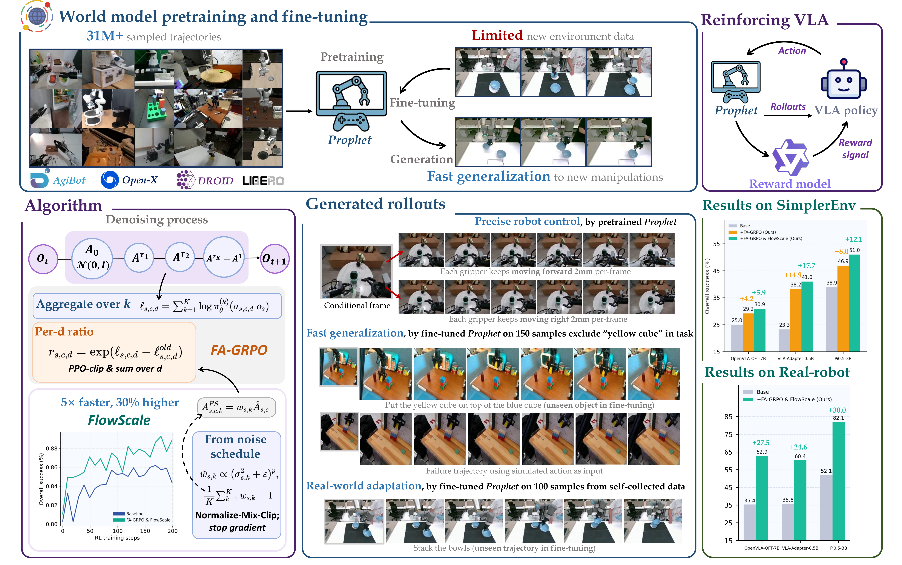

<div align="center">

# Reinforcing Action Policies by *Prophesying*

[Paper](https://arxiv.org/abs/2511.20633) · [Project Page](https://LogosRoboticsGroup.github.io/ProphRL/) · [World Models](https://huggingface.co/Fleurrr/Prophet-World-Model) · [Pi05 Policy](https://huggingface.co/Fleurrr/OpenPI05-Bridge-RL) · [RL Data](https://huggingface.co/datasets/Fleurrr/Bridge-RL-Data)

Jiahui Zhang<sup>1,3,*</sup>, Ze Huang<sup>1,3,*</sup>, Chun Gu<sup>1,2,3</sup>, Zipei Ma<sup>1,2</sup>, [Li Zhang](https://lzrobots.github.io/)<sup>1,2,3</sup>

<sup>1</sup>School of Data Science, Fudan University · <sup>2</sup>Shanghai Innovation Institute · <sup>3</sup>Logos Robotics · <sup>*</sup>Equal contribution



</div>

## Overview

ProphRL improves vision-language-action policies through reinforcement learning inside a learned robot world model. Its world model, **Prophet**, predicts future robot observations from an initial frame, action chunks, and visual history. The full method additionally introduces FA-GRPO and FlowScale for VLA post-training.

## Abstract

Vision-Language-Action policies are commonly trained through imitation and can be brittle under distribution shift, while real-world reinforcement learning is expensive and conventional simulators are difficult to engineer and transfer. ProphRL addresses these limitations with Prophet, a unified action-to-video robot world model pretrained on heterogeneous robot trajectories and adapted to downstream environments through full-parameter fine-tuning. The complete method reinforces VLA policies inside Prophet using Flow-action-GRPO and FlowScale. This repository releases both the Prophet world model and the VLA reinforcement-learning implementation.

This repository is organized by method component so that the world-model and RL implementations remain independently installable:

```text
ProphRL/
├── world_model/     # Prophet training, checkpoints, and rollout generation
├── rl/              # FA-GRPO, FlowScale, VLM reward, and VLA post-training
└── docs/            # Project assets
```

## Components

The `world_model/` component contains:

- public pretrained, BRIDGE, and LIBERO checkpoints;
- BRIDGE RLDS and LIBERO HDF5 data conversion tools;
- full-parameter BRIDGE and LIBERO fine-tuning;
- an automatic-download inference demo plus open-loop/autoregressive rollout generation;
- checkpoint validation and release metadata.

See [`world_model/README.md`](world_model/README.md) for installation and usage.

The `rl/` component contains:

- Pi05, VLA-Adapter, and OpenVLA-OFT-Flow policy backends;
- Prophet/Cosmos closed-loop rollout integration;
- VLM reward evaluation;
- FA-GRPO and FlowScale training with FSDP;
- checkpoint merge utilities and BRIDGE experiment entry points.

See [`rl/README.md`](rl/README.md) for environment setup, assets, path configuration, and training commands.

## Quick Start

```bash
cd world_model
python -m pip install -e . --no-deps
python scripts/download_base_models.py

prophet-demo \
  --variant libero \
  --input /path/to/conditioning.mp4 \
  --actions /path/to/actions.npz \
  --base-checkpoints checkpoints \
  --output outputs/libero_demo.mp4
```

`prophet-demo` downloads the selected Prophet checkpoint from Hugging Face automatically. Data conversion and fine-tuning commands are documented in [`world_model/docs/DATA.md`](world_model/docs/DATA.md) and [`world_model/README.md`](world_model/README.md).

From the repository root, run the RL setup and a configuration-only training check:

```bash
cd rl
python -m pip install -e ".[train,dev]"
SFT_MODEL_PATH=checkpoints/policy/pi05-bridge \
DRY_RUN=1 bash examples/exp/Pi05_exp/train/exp1-pi05_wm_fs_bridge_carrot.sh
```

The RL scripts default to the sibling `world_model/` directory and its `checkpoints/prophet/prophet-bridge.pt` checkpoint. See [`rl/README.md`](rl/README.md) for the full CUDA environment and asset preparation steps.

## License

The world-model component is distributed under Apache-2.0; the original RL code is distributed under the MIT License and includes third-party notices for derived modules. Prophet checkpoints are derivative models of NVIDIA Cosmos-Predict2 and are distributed separately under the NVIDIA Open Model License. See `world_model/release/`, `rl/LICENSE`, and `rl/THIRD_PARTY_NOTICES.md` for details.

Built on NVIDIA Cosmos.

## Citation

```bibtex
@article{zhang2025prophrl,
    title={Reinforcing Action Policies by Prophesying},
    author={Zhang, Jiahui and Huang, Ze and Gu, Chun and Ma, Zipei and Zhang, Li},
    year={2025},
    journal={arXiv preprint arXiv:2511.20633},
}
```
